# Kelter — architecture

Kelter is a governed-microkernel runtime for AI-agent orchestration. Its
founding inversion: **the deterministic kernel is the runtime; the model is a
constrained policy oracle.** The model *proposes* actions; the kernel
*validates and executes* them. Reliability is enforced in code, not asked of
the model — so the same orchestration runs on a 0.5B local model or a frontier
model and stays trustworthy either way.

This document synthesises the accepted ADRs (0001–0009) into one picture. The
governed-multi-agent work (Phase 4b) is delivered; plan mode (Phase 4c) is
planned. Each section cites its ADR; see the index at the end.

---

## 1. The core inversion (ADR 0001)

The prevailing pattern makes the LLM the runtime — the model's tool calls *are*
the control flow, so orchestration reliability equals tool-calling reliability
and a weak engine breaks everything. Kelter inverts this: a typed,
deterministic state machine (`kernel-core::engine`) owns control flow, retries,
persistence and error handling, and the model is consulted only at explicit
decision points.

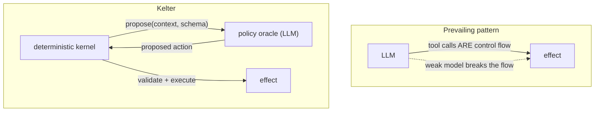

The contract is a single interface, `propose(context, action_schema) ->
proposed_action`. The crucial detail: `ValidatedAction` has no public
constructor other than `ActionSchema::validate`, so unvalidated model output
**cannot reach the executor by construction**.

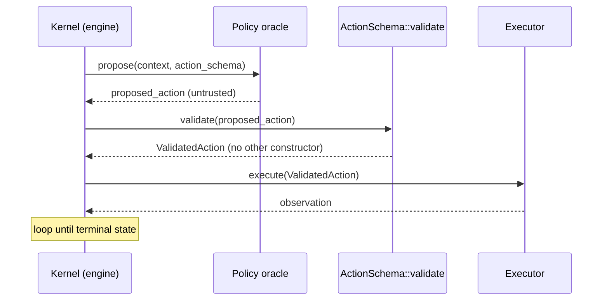

Consequences: reliability degrades in decision *quality*, not flow integrity
(graceful degradation); the kernel is fully testable with a scripted mock
oracle (`kernel-core/tests/engine_test.rs`) with no model at all; every model
interaction is one explicit decision point — open-ended "let the model run"
autonomy is deliberately out of scope.

---

## 2. System layers

One block diagram of the whole runtime: stateless clients over a single API
contract, the deterministic kernel at the centre, the policy plane it consults,
and the capability registry that governs every extension.

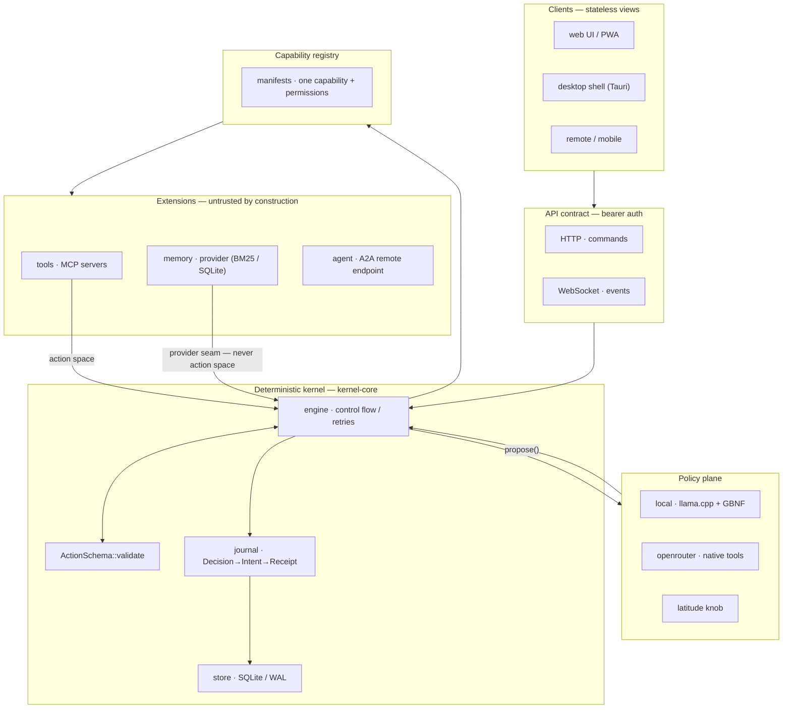

---

## 3. The request lifecycle

A full run, end to end. Note where the journal is written: the Decision entry
lands the moment a proposal passes validation — *before* anything acts on it.

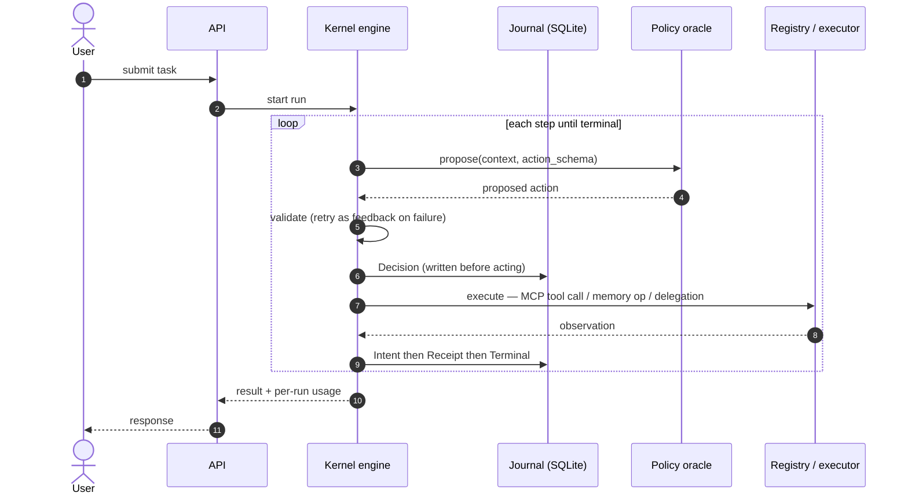

---

## 4. Policy plane — one contract, two mechanisms (ADR 0003)

Different engines guarantee action-shape correctness differently. The adapter
contract is: **return a proposal drawn from the offered schema, or fail
loudly** (`PolicyOracle::propose`). Each adapter satisfies it with the
strongest mechanism its engine offers — and the kernel re-validates regardless,
because it trusts no adapter.

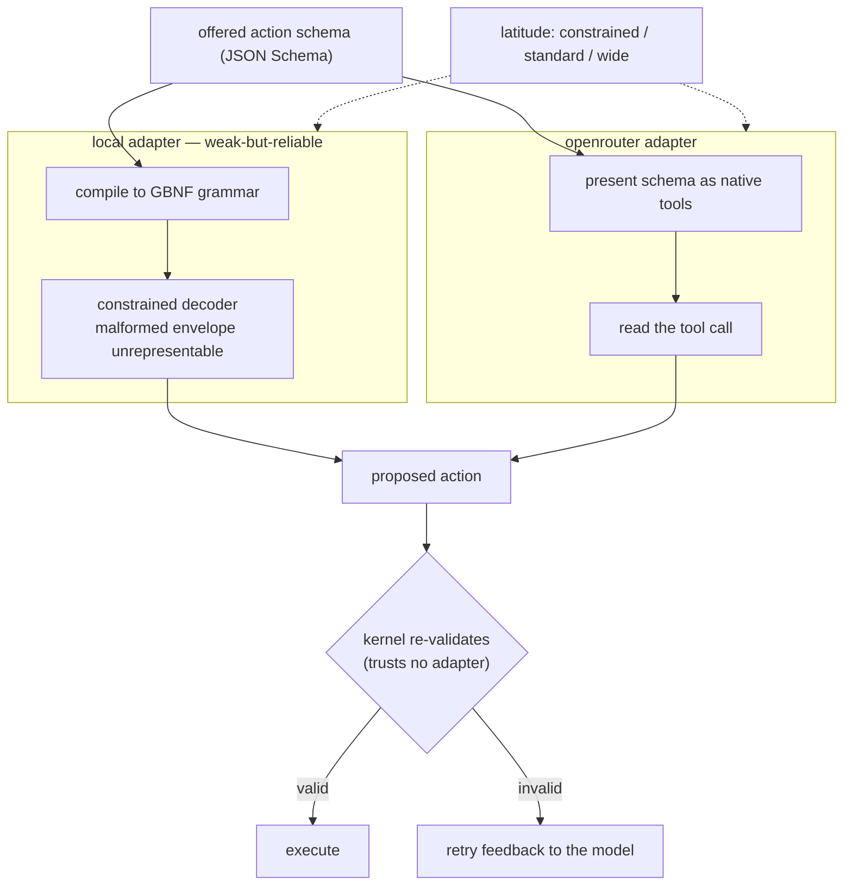

Constrained decoding and native tool-calling are optimisations for proposal
*quality*, not the trust boundary. The latitude knob widens or narrows the
action-space treatment per engine capability: tighter guidance and more
validation retries for weak engines, more freedom for strong ones — same
kernel, different latitude. An engine swap is a config change, never an
orchestration rewrite.

---

## 5. Tools via MCP — zero custom plugin API (ADR 0002)

The kernel has no bespoke plugin API. Every tool is an MCP server; the `mcp`
crate is an MCP *client* that spawns configured stdio servers, converts their
tool JSON Schemas into the kernel's action space, and executes validated
actions as MCP tool calls. Built-in and third-party tools travel the exact same
protocol path.

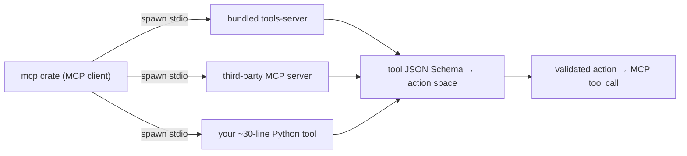

One schema language end to end (JSON Schema is exactly what the kernel
validates proposals against), ecosystem interop for free, and protocol overhead
accepted even for built-in tools to keep one honest path.

---

## 6. Memory (ADR 0005)

Memory is a provider behind a three-method trait. Retrieval is real BM25
ranking with zero dependencies; embeddings are an optional backend behind the
same trait, switchable by config (see roadmap).

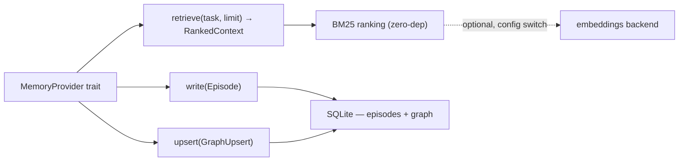

---

## 7. Capability registry & the governed extension model (ADR 0006 + 0008)

This is the heart of the platform. ADR 0006 sets the principle — *open like a
runtime, governed like a kernel*: extensions are untrusted by construction and
governance (validation, authorization, journal) is non-bypassable. ADR 0008
generalises the tool-only loader into a **capability registry**: one manifest
declares exactly one capability plus its permissions, and the registry routes
each accepted extension to its kernel seam.

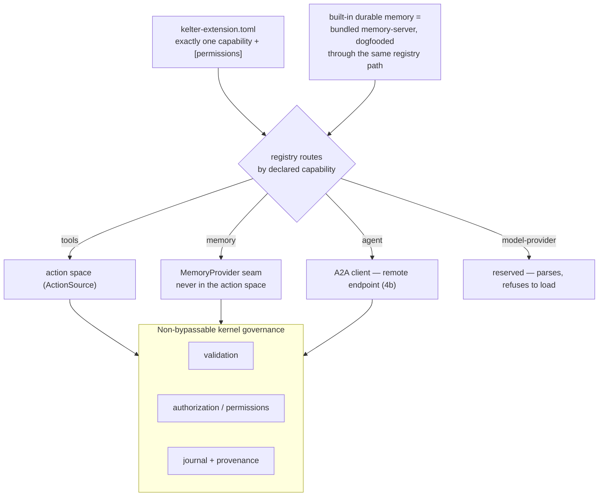

Key properties: it is the **registry, not the protocol**, that keeps memory
tools out of the model's action space; memory reuses MCP (three reserved tools,
`memory_write` / `memory_retrieve` / `memory_upsert`, mapping 1:1 onto the
provider trait) rather than a bespoke protocol; unknown capabilities refuse to
load (forward-compatible manifests, never silently ignored); and the built-in
memory has no privileged in-process path — it is spawned through the same
registry seam as any third-party backend (the ADR 0006 dogfood rule, enforced
in code).

---

## 8. Durable execution (ADR 0007)

The kernel journals a run as a fold over per-step entries. Because the Decision
entry is written the instant a proposal validates — before any effect — replay
can reconstruct the run without ever re-querying the model.

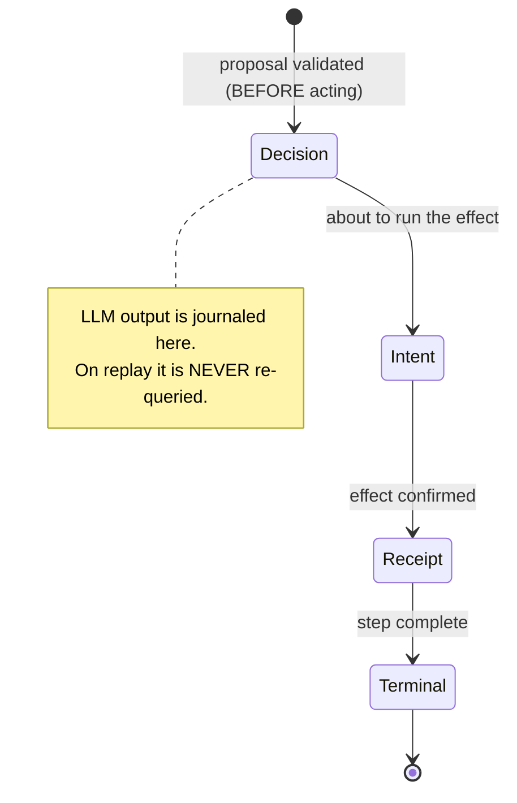

Crash-resume, and the exactly-once side-effect money-shot:

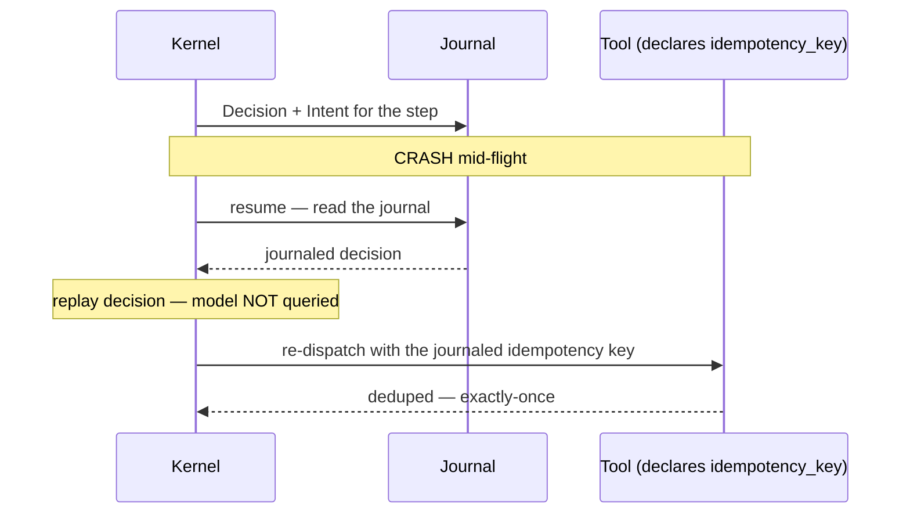

Exactly-once holds for cooperating tools that declare `idempotency_key`
(kernel-injected as `run_id:step`); tools without it get an honest-failure
resume (a dangling intent fails loudly as "manual check required") — at-most-
once, never silent duplication. Storage is one SQLite file (WAL) for runs,
journal, episodes and graph; OpenTelemetry spans (`kelter.run/step/model_call/
validate/tool_call`) are available and off by default.

---

## 9. Topology as config (ADR 0004)

There is exactly one kernel (`kernel-core`, a library crate) and one API
contract (HTTP for commands, WebSocket for events, bearer auth). Which topology
you get is a configuration decision, not a separate codebase.

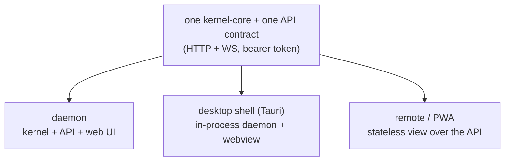

The kernel owns all state; clients are stateless views. The engine choice is
one config line (`[policy] engine = ...`). A fix lands in all three topologies
at once. Network-level trust (e.g. a tailnet) composes on top; the API is not
meant to be exposed publicly without hardening. Multi-master offline/online
sync (CRDTs) is explicitly out of scope — the single-kernel model avoids
needing it.

---

## 10. Governed, durable A2A — outbound (ADR 0009, Phase 4b)

Phase 4b implements the reserved `agent` seam: Kelter as a **governed A2A
client** that delegates tasks to remote agents. An `agent` extension declares a
remote Agent Card endpoint (`[agent] card_url`) and MUST request the `network`
permission — an agent manifest without it is refused at startup. Each remote
agent appears in the action space as `delegate_to_<name>(task)`; the kernel —
not an untrusted subprocess — makes the outbound call, so it enforces the
permission and an SSRF defence at its own egress.

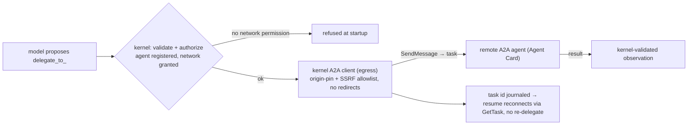

Two properties make this more than an A2A client. The delegation is
**durable**: the created task id is journaled the instant the task exists, so a
crash mid-delegation resumes by reconnecting with `GetTask(id)` and never
re-sending — exactly-once delegation across a kill. And network egress is
**governed at the kernel**: the client is pinned to the origin (scheme + host +
port) of the declared `card_url`, the Agent Card's advertised endpoint is
refused if it differs, and HTTP redirects are disabled — neither the model nor
a hostile card can redirect the dial (e.g. to a cloud metadata IP). A lying
agent's unknown task state is rejected as a protocol violation, remote
timeouts/failures degrade the step explicitly, and per-agent wall-time plus
delegation counts aggregate onto `run.agent_usage`.

This closes the ADR 0008 `network` deferral for the seam the kernel controls.
The honest remaining gap — arbitrary egress from a spawned tool/memory
subprocess — is a different seam and stays staged (a network-restricted
sandbox: `--network none` / WASM). The A2A client is a minimal, own
implementation (`reqwest` + `serde`, no SDK) precisely so the egress is
trivially wrappable in that origin-pin gate.

---

## 11. Planned — plan mode (Phase 4c)

The model proposes a plan as a DAG of steps with dependencies; the kernel
validates it (schema, allowed actions, no cycles) and executes it durably, so
plans inherit resume and idempotency. A plan node can be a tool call, an A2A
sub-agent delegation, or a review step — planning composes the rest of the
layer, and schema-constrained plans stay reliable even on a small local model.

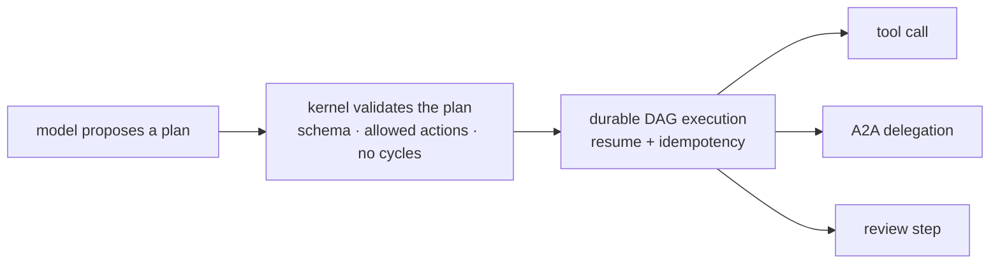

---

## 12. Cross-cutting — the trust boundary

The single invariant under every ADR: nothing the model or an extension
produces is trusted; the kernel is the only thing that validates, executes,
journals and attributes.

| Component | Trusted? | Contained by |
| --- | --- | --- |
| Policy oracle (model proposal) | No | `ActionSchema::validate` — no other constructor for `ValidatedAction` |
| Tool / memory / agent extension | No | capability routing + permissions + response validation |
| Adapter (local / openrouter) | No | kernel re-validates every proposal |
| Remote A2A agent | No | origin-pin egress + kernel-validated observation |
| Kernel (engine, journal, store, validation) | Yes | it *is* the trust boundary |

---

## ADR index

| ADR | Title | Section |
| --- | --- | --- |
| 0001 | Deterministic kernel as the runtime, LLM as a constrained policy oracle | 1 |
| 0002 | MCP as the only tool/plugin substrate | 5 |
| 0003 | Adapter contract — constrained decoding locally, native tool-calling remotely | 4 |
| 0004 | One kernel, topology as config, thin-by-default clients | 9 |
| 0005 | Memory provider interface | 6 |
| 0006 | Governed microkernel extension model | 7 |
| 0007 | Durable execution — journal & replay | 8 |
| 0008 | The capability registry — one manifest, many kernel seams | 7 |
| 0009 | Governed, durable outbound A2A | 10 |
